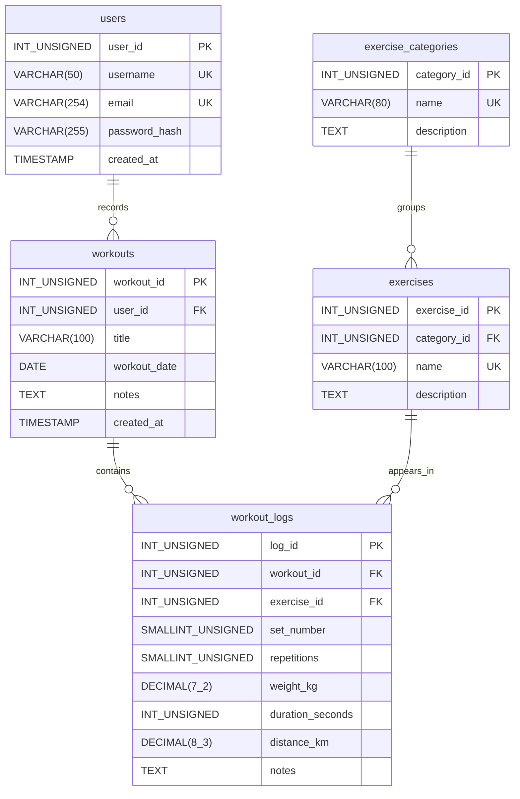

# Fitness Tracker

A PHP and MariaDB application for account registration, workout and exercise CRUD,
exercise search, workout history, and a dashboard of recent activity and statistics.

## Data Model

| Entity | Purpose | Primary key | Foreign keys |
| --- | --- | --- | --- |
| users | Accounts and password hashes | user_id | None |
| exercise_categories | Shared exercise classifications | category_id | None |
| exercises | Shared searchable exercise catalog | exercise_id | category_id |
| workouts | A user's dated workout sessions | workout_id | user_id |
| workout_logs | Sets or timed segments performed in a workout | log_id | workout_id, exercise_id |



Each workout belongs to exactly one user; a user may have zero or many workouts.
Each exercise belongs to exactly one category; a category may have zero or many exercises.
Each log belongs to exactly one workout and one exercise; each parent may have zero or many logs.
Workouts and exercises have a many-to-many relationship resolved through workout_logs.
Multiple sets of an exercise have separate log rows. Set numbers must be unique within
one workout/exercise pair. A workout may be empty while being drafted.

### Attributes and constraints

The diagram lists every column; exact SQL types, nullability, defaults, and constraints
are defined in database/schema.sql. In Mermaid, INT_UNSIGNED represents INT UNSIGNED;
DECIMAL(7_2) and DECIMAL(8_3) represent DECIMAL(7,2) and DECIMAL(8,3).
Usernames, emails, category names, and exercise names are unique. IDs auto-increment.
Required columns use NOT NULL. Descriptions, notes, and inapplicable measurements may be NULL.
At least one of repetitions, duration_seconds, or distance_km must be supplied for a log.
Weight uses kilograms, distance uses kilometers, and duration uses seconds.

Deleting a user deletes their workouts and logs. Deleting a workout deletes its logs.
Deleting a referenced exercise or category is restricted to preserve workout history;
the interface must explain this restriction. Unused exercises and categories can be deleted.
The exercise catalog is shared; the PHP app must define who may edit it.

### Application behavior

Use PHP password_hash() when registering and password_verify() when logging in;
never store plaintext passwords. Use prepared statements for database queries.
Before reading or changing a workout or its logs, verify that workouts.user_id matches
the authenticated user. Compute dashboard counts and progress summaries from the
workouts and workout_logs tables rather than storing duplicate totals.
Progress includes changes in repetitions, weight, distance, and duration over dates.

## Import into MariaDB

1. Extract this package and place its contents at the root of your team's repository.
2. Open http://<your-vm-ip>/phpmyadmin and log in.
3. Select Import, choose database/schema.sql, and click Go. This script creates and selects
   fitness_tracker, so the account must have CREATE DATABASE permission.
4. Select fitness_tracker and confirm these five tables: users, exercise_categories,
   exercises, workouts, workout_logs.
5. Capture the browser with its address and all five tables visible; save it as
   screenshots/database-tables.png.

Alternatively, from the repository root on the VM:

```bash
mariadb -u root -p < database/schema.sql
mariadb -u root -p fitness_tracker -e "SHOW TABLES;"
```

Import once into a fresh database. CREATE TABLE deliberately fails if a table already
exists; this is not a migration script and does not delete existing data. If an import
fails, inspect the error before retrying. This package has not been executed against
your VM's MariaDB; the successful import and screenshot are required verification.

## GitHub and submission

Use one repository for the semester and add every team member as a collaborator.
If a README already exists, merge this Data Model section into it and preserve existing content.
After importing successfully and adding the screenshot, run from your existing clone:

```bash
git add README.md database/schema.sql screenshots/
git commit -m "Add fitness tracker database model and schema"
git push
```

If you have no repository yet, create one on GitHub, add collaborators under Settings,
and clone it before copying these files into the clone. Submit the team's repository
URL on Canvas. Do not commit database passwords or credentials.
